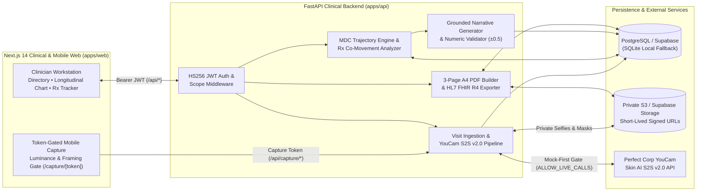

<div align="center">

# DermBridge® — Longitudinal Clinical Dermatology Workstation

**Bridging consumer-grade skin AI to clinical longitudinal decision-support, prescription response tracking, and HL7 FHIR R4 interoperability.**

[](https://nextjs.org/)
[](https://fastapi.tiangolo.com/)
[](https://www.python.org/)
[](https://www.sqlalchemy.org/)
[](https://www.perfectcorp.com/)
[](https://hl7.org/fhir/R4/)
[](./apps/api/tests)

> **Clinical Decision-Support Notice:** *For clinician review — not a diagnosis.* All quantitative trajectories, Minimum Detectable Change (MDC) verdicts, and medication co-movement hypotheses are designed strictly to assist licensed clinicians during patient consultations.

</div>

---

## Table of Contents

1. [Executive Overview](#executive-overview)
2. [System Architecture](#system-architecture)
3. [Core Clinical Capabilities](#core-clinical-capabilities)
4. [Frozen 12-Concern Clinical Matrix (`ANALYSIS_VERSION = 1`)](#frozen-12-concern-clinical-matrix-analysis_version--1)
5. [Quickstart — Local Development](#quickstart--local-development)
6. [Seeded Demo Cohort & Credentials](#seeded-demo-cohort--credentials)
7. [API Reference](#api-reference)
8. [Production Deployment (Vercel + Supabase)](#production-deployment-vercel--supabase)
9. [Testing & Quality Assurance](#testing--quality-assurance)
10. [Repository Structure](#repository-structure)
11. [Security, Privacy & Clinical Governance](#security-privacy--clinical-governance)

---

## Executive Overview

**YouCam powers virtual skin analysis for 800+ consumer brands; DermBridge® is the clinical bridge to the dermatology workstation.**

Dermatology consultations frequently rely on subjective visual recall across visits spaced 4 to 12 weeks apart, making it difficult to separate true therapeutic response from lighting noise or concurrent OTC regimen changes. **DermBridge®** transforms single-point skin scans into a rigorous longitudinal clinical record:

- **Guided Patient Intake:** Clinicians issue short-lived, cryptographically signed mobile capture links (`/capture/{token}`) with real-time client-side luminance, contrast, and framing quality gates.
- **Immutable Longitudinal Scoring:** Every visit records 12 standardized skin concern scores (`0–100`) and private zone masks under a frozen `analysis_version`.
- **Noise-Filtered MDC Verdicts:** Score deltas between baseline and follow-up visits are evaluated against per-concern **Minimum Detectable Change (MDC)** thresholds (`±4.0` to `±5.0` points over `≥21` days) before classifying a trajectory as `improving`, `stalled`, or `worsening`.
- **Automated Prescription (Rx) Cross-Referencing:** Active topical and systemic regimens (with RxNorm coding) are temporally correlated against targeted skin concerns to surface therapeutic response or potential adverse flares.
- **Zero-Hallucination Grounded Narratives:** The clinical narrative layer operates strictly on structured numeric JSON—never raw patient imagery—and validates every emitted number against database `concern_scores` (`±0.5` tolerance) before display.
- **EHR-Ready Exports:** One-click generation of a **3-page A4 Consultation PDF Report** and a standards-compliant **HL7 FHIR R4 `Observation` Bundle**.

---

## System Architecture



---

## Core Clinical Capabilities

| Capability | Technical Implementation | Clinical Value |
| :--- | :--- | :--- |
| **Longitudinal Trajectory Matrix** | Compares baseline vs. latest visit across all 12 concerns with inline SVG sparklines, signed delta ($\Delta$), percentage change, and severity badges (`clear`, `mild`, `moderate`, `severe`). | Eliminates guesswork across multi-month treatment arcs (`≥2` visits, `≥21` days). |
| **Prescription (Rx) Co-Movement** | Maps medications (`topical_retinoid`, `topical_acid`, `barrier_repair`, `oral_antibiotic`, `hormonal_antiandrogen`, `sunscreen_spf`, etc.) to primary/secondary target concerns and evaluates post-initiation deltas against MDC. | Automatically flags `clinically_responsive`, `early_favorable_trend`, `minimal_change`, or `potential_adverse_flare`. |
| **Numeric Grounding Validator** | Extracts every numeric token from generated clinical summaries and hypotheses, verifying each against source `concern_scores` within `±0.5` ([`validate.py`](./apps/api/app/services/agent/validate.py)). | Guarantees zero ungrounded numeric claims; falls back deterministically to [`narrative_fallback.md`](./templates/narrative_fallback.md) on any schema or numeric mismatch. |
| **3-Page A4 Consultation PDF** | Server-side rendering via WeasyPrint + deterministic `pydyf`/Matplotlib A4 renderer ([`build.py`](./apps/api/app/services/report/build.py)) with embedded 3-point sparklines, cached mask overlays, and top-3 trajectory charts. | Produces a print-ready, chart-ready 3-page A4 clinical summary in `<2s`. |
| **HL7 FHIR R4 Interoperability** | Exports every visit measurement as a coded FHIR R4 `Observation` entry inside a `collection` `Bundle` ([`fhir.py`](./apps/api/app/services/report/fhir.py)). | Enables direct ingestion into downstream EHR/EMR clinical data repositories. |
| **Mock-First Budget Protection** | `ALLOW_LIVE_CALLS=false` is enforced by default. Every task creation logs `len(dst_actions)` units to `logs/unit_budget.csv` against a 1,000-unit ledger. | Protects API quotas during development, CI/CD, and clinical demos while maintaining identical payload shapes between mock and live modes. |

---

## Frozen 12-Concern Clinical Matrix (`ANALYSIS_VERSION = 1`)

To prevent longitudinal drift across clinic visits, the 12 Perfect Corp YouCam S2S v2.0 concern actions, their direction of clinical improvement, and their **Minimum Detectable Change (MDC)** thresholds are version-locked:

| # | Action Key | Clinical Label | Direction of Good | MDC Threshold | Clinical Interpretation |
| :-: | :--- | :--- | :--- | :-: | :--- |
| 1 | `acne` | Acne & Blemishes | `lower_is_better` | `±5.0` | Falling score ($\Delta \le -5.0$) indicates lesion clearance |
| 2 | `wrinkle` | Wrinkles & Fine Lines | `lower_is_better` | `±4.0` | Falling score ($\Delta \le -4.0$) indicates rhytid reduction |
| 3 | `pores` | Visible Pores | `lower_is_better` | `±4.0` | Falling score ($\Delta \le -4.0$) indicates pore refinement |
| 4 | `texture` | Skin Texture Roughness | `lower_is_better` | `±4.0` | Falling score ($\Delta \le -4.0$) indicates smoother epidermal surface |
| 5 | `redness` | Erythema / Redness | `lower_is_better` | `±5.0` | Falling score ($\Delta \le -5.0$) indicates reduced vascular erythema |
| 6 | `oiliness` | Sebum / Oiliness | `lower_is_better` | `±5.0` | Falling score ($\Delta \le -5.0$) indicates sebum normalization |
| 7 | `moisture` | Skin Moisture | `higher_is_better` | `±5.0` | Rising score ($\Delta \ge +5.0$) indicates improved stratum corneum hydration |
| 8 | `radiance` | Skin Radiance | `higher_is_better` | `±4.0` | Rising score ($\Delta \ge +4.0$) indicates improved luminous reflectance |
| 9 | `firmness` | Skin Firmness | `higher_is_better` | `±4.0` | Rising score ($\Delta \ge +4.0$) indicates improved dermal elasticity |
| 10 | `dark_circle_v2` | Periorbital Dark Circles | `lower_is_better` | `±4.0` | Falling score ($\Delta \le -4.0$) indicates periorbital brightening |
| 11 | `dark_spot` | Hyperpigmentation / Spots | `lower_is_better` | `±4.0` | Falling score ($\Delta \le -4.0$) indicates pigment/melanin reduction |
| 12 | `skin_tone` | Skin Tone Evenness | `higher_is_better` | `±4.0` | Rising score ($\Delta \ge +4.0$) indicates more uniform chromophore distribution |

> Movements where $|\Delta| < \text{MDC}$ or where follow-up duration is `< 21` days (`< 2` visits) are automatically classified as `stalled` or `insufficient_data` to prevent over-interpreting capture noise.

---

## Quickstart — Local Development

### Prerequisites

- **Python** `3.11+`
- **Node.js** `18.17+` (with `npm`)
- **Database:** Works out of the box with local **SQLite** (`dermobridge.db`) or **PostgreSQL 15+ / Supabase**

### 1. Clone & Configure Environment

```bash
git clone https://github.com/NOBA235/dermatology-bridge.git
cd dermatology-bridge
cp .env.example .env
```

By default, `.env.example` configures `ALLOW_LIVE_CALLS=false` (deterministic mock pipeline) and local SQLite storage so you can run the entire stack offline with zero external API keys.

### 2. Start the FastAPI Backend (`apps/api`)

**macOS / Linux:**
```bash
cd apps/api
python3 -m venv .venv
source .venv/bin/activate
pip install -e ".[dev]"
alembic upgrade head
python -m app.scripts.seed
uvicorn app.main:app --reload --port 8000
```

**Windows (PowerShell):**
```powershell
cd apps\api
python -m venv .venv
.\.venv\Scripts\Activate.ps1
pip install -e ".[dev]"
alembic upgrade head
python -m app.scripts.seed
uvicorn app.main:app --reload --port 8000
```

Verify the API health endpoint at [`http://localhost:8000/health`](http://localhost:8000/health):
```json
{
  "status": "ok",
  "database": "connected",
  "allow_live_calls": false,
  "disclaimer": "For clinician review — not a diagnosis."
}
```

### 3. Start the Next.js Clinician Workstation (`apps/web`)

Open a second terminal:

```bash
cd apps/web
npm install
npm run dev
```

Open [`http://localhost:3000`](http://localhost:3000) in your browser.

---

## Seeded Demo Cohort & Credentials

Running `python -m app.scripts.seed` (or starting the serverless runtime on an empty database) idempotently seeds **Bridge Dermatology Clinic** with a demo clinician account and two patient charts:

### Clinician Sign-In (`/login`)

| Field | Value |
| :--- | :--- |
| **Clinician Name** | Dr. Maya Chen, MD |
| **Clinic** | Bridge Dermatology Clinic |
| **Email Address** | `dr.chen@bridgederm.local` |
| **Password** | `BridgeDerm2026!` *(also accepts `clinician-demo-pass` in automated tests)* |

### Pre-Populated Patient Charts

1. **Elena Rostova (`PT-DEMO-001`) — 90-Day Longitudinal Case Study (3 Visits, 4 Medications):**
   - **Visit 1 (`2026-07-15`):** Baseline presentation with inflammatory acne (`68.0`), erythema (`62.0`), and barrier dehydration (`42.0`). Initiated *Adapalene 0.1% Gel* (RxNorm `1362243`) and *Ceramide Barrier Cream*.
   - **Visit 2 (`2026-08-29`):** Marked improvement in acne (`51.0`) and moisture (`58.0`); added *Niacinamide 5% Serum*.
   - **Visit 3 (`2026-10-13`):** Clinically responsive acne (`38.0`, $\Delta -30.0$) and hydration (`71.0`, $\Delta +29.0$), alongside a new hyperpigmentation rebound (`dark_spot` `32.0 → 51.0`, $\Delta +19.0$) temporally correlated with an OTC *Glycolic Acid 10% Exfoliating Toner* started without strict broad-spectrum SPF reapplication.
2. **Alex Rivera (`PT-0001`) — New Intake Baseline (0 Visits):**
   - Ready for testing initial guided mobile selfie capture or direct clinical photo upload.

---

## API Reference

All `/api/*` routes (except token-scoped `/api/capture/*`) require an `Authorization: Bearer <jwt>` clinician header.

| Method | Endpoint | Auth | Description |
| :---: | :--- | :---: | :--- |
| `GET` | `/health` | Public | Database connectivity check and `allow_live_calls` gate status |
| `POST` | `/auth/login` | Public | Authenticate clinician credentials and issue an HS256 JWT (`480m` TTL) |
| `GET` | `/api/me` | Clinician JWT | Retrieve authenticated clinician profile and clinic metadata |
| `GET` | `/api/patients` | Clinician JWT | List or search (`?q=`) enrolled patient charts in the clinician's clinic |
| `POST` | `/api/patients` | Clinician JWT | Enroll a new patient chart with consent version tracking |
| `GET` | `/api/patients/{id}` | Clinician JWT | Retrieve patient demographics, visit count, and latest scan date |
| `DELETE` | `/api/patients/{id}` | Clinician JWT | Permanently delete patient chart, visits, and private storage objects |
| `GET` | `/api/patients/{id}/visits` | Clinician JWT | List chronological visits and 12-concern scores for a patient |
| `POST` | `/api/visits` | Clinician JWT | Upload a visit selfie (`multipart/form-data`) and run the YouCam pipeline |
| `GET` | `/api/patients/{id}/trends` | Clinician JWT | Compute baseline-to-latest deltas, `%` changes, and MDC verdicts |
| `GET` | `/api/patients/{id}/flags` | Clinician JWT | Retrieve top-3 prioritized concerns, grounded narrative, and hypotheses |
| `GET` | `/api/patients/{id}/medications` | Clinician JWT | List active and historical medications/regimens for a patient |
| `POST` | `/api/patients/{id}/medications` | Clinician JWT | Record a new prescription or topical regimen (with optional RxNorm code) |
| `DELETE` | `/api/patients/{id}/medications/{med_id}` | Clinician JWT | Remove a medication record from a patient chart |
| `GET` | `/api/patients/{id}/medication-correlations` | Clinician JWT | Cross-reference active regimens against longitudinal skin concern deltas |
| `POST` | `/api/patients/{id}/capture-token` | Clinician JWT | Generate a 30-minute signed HS256 token for patient mobile capture |
| `GET` | `/api/capture/{token}` | Capture Token | Validate mobile capture link and return patient first name & consent info |
| `POST` | `/api/capture/{token}/submit` | Capture Token | Submit guided patient selfie and trigger longitudinal flag regeneration |
| `GET` | `/api/patients/{id}/report.pdf` | Clinician JWT | Generate and stream the 3-page A4 clinical consultation PDF report |
| `GET` | `/api/patients/{id}/fhir/observations` | Clinician JWT | Export all patient visit scores as an HL7 FHIR R4 `Observation` Bundle |

---

## Production Deployment (Vercel + Supabase)

This repository is pre-configured to deploy as a unified **Vercel Services** project via the root [`vercel.json`](./vercel.json):

- `apps/web` → Next.js 14 frontend (`/*`)
- `apps/api` → FastAPI serverless backend (`/api/*`, `/auth/*`, `/health`)

### Step 1: Import Repository on Vercel

1. Push your repository to GitHub and click **Add New → Project** in Vercel.
2. Keep the **Root Directory** set to `./` (the repository root) so Vercel detects [`vercel.json`](./vercel.json) and builds both `web` and `api` services automatically.

### Step 2: Configure Environment Variables (`api` Service)

> [!IMPORTANT]
> **Supabase IPv4 Pooler Requirement:** Direct Supabase database hosts (`db.<project_ref>.supabase.co:5432`) resolve to IPv6 only. Because Vercel Serverless Functions use IPv4 outbound networking, always use the **Supabase Supavisor IPv4 Pooler** URL (`aws-0-<region>.pooler.supabase.com:6543`). DermBridge's [`normalize_database_url`](./apps/api/app/db/session.py) also automatically rewrites direct Supabase URLs to the IPv4 pooler with `prepare_threshold=None`.

| Variable | Required | Default / Example | Purpose |
| :--- | :---: | :--- | :--- |
| `DATABASE_URL` | Recommended | `postgresql://postgres.<ref>:<pass>@aws-0-eu-west-1.pooler.supabase.com:6543/postgres?sslmode=require` | Managed Postgres connection string (falls back to seeded `/tmp` SQLite if unset) |
| `JWT_SECRET_KEY` | Recommended | `<32+-byte-random-hex-secret>` | HS256 signing key for clinician JWTs and capture tokens |
| `ALLOW_LIVE_CALLS` | Yes | `false` | Set to `true` only when live Perfect Corp S2S v2.0 API calls are approved |
| `YOUCAM_API_KEY` | If live | `sk-...` | Perfect Corp YouCam S2S v2.0 Bearer API key |
| `YOUCAM_BASE_URL` | No | `https://yce-api-01.perfectcorp.com` | Perfect Corp S2S v2.0 gateway base URL |
| `STORAGE_BACKEND` | No | `local` (`s3` in prod) | Set to `s3` to persist selfies and masks in private S3 / Supabase Storage |
| `STORAGE_BUCKET` | If `s3` | `dermobridge-private` | Private S3 bucket name |
| `STORAGE_ENDPOINT_URL` | If `s3` | `https://<ref>.supabase.co/storage/v1/s3` | S3-compatible endpoint URL |
| `STORAGE_ACCESS_KEY_ID` | If `s3` | `<s3-access-key-id>` | S3 access key ID |
| `STORAGE_SECRET_ACCESS_KEY` | If `s3` | `<s3-secret-access-key>` | S3 secret access key |
| `STORAGE_REGION` | No | `us-east-1` | S3 storage region |

### Step 3: Initialize Production Schema & Seed Data

Against your production `DATABASE_URL`, apply Alembic migrations and (optionally) seed the demo cohort:

```bash
cd apps/api
alembic upgrade head
python -m app.scripts.seed
```

---

## Testing & Quality Assurance

The backend includes a hermetic **31-test Pytest suite** covering database migrations, idempotent seeding, JWT & capture-token security boundaries, exponential backoff polling, MDC verdict math, medication correlations, numeric hallucination validation, 3-page A4 PDF byte inspection, and FHIR R4 schema conformance.

```bash
cd apps/api
pytest -v
```

> All tests automatically run with `ALLOW_LIVE_CALLS=false` via an `autouse` fixture in [`conftest.py`](./apps/api/tests/conftest.py), ensuring zero live API budget consumption during test runs.

---

## Repository Structure

```text
dermatology-bridge/
├── apps/
│   ├── api/                            # FastAPI clinical backend
│   │   ├── alembic/                    # Database migrations (PostgreSQL & SQLite)
│   │   ├── app/
│   │   │   ├── api/                    # REST routers (patients, visits, capture, schemas)
│   │   │   ├── auth/                   # HS256 JWT utilities, middleware, and /auth/login
│   │   │   ├── db/                     # SQLAlchemy 2.0 ORM models and session/pooler manager
│   │   │   ├── domain/                 # Frozen 12 concerns, MDC thresholds, severity, Rx domain
│   │   │   ├── scripts/                # Idempotent clinic & 90-day longitudinal cohort seed
│   │   │   └── services/
│   │   │       ├── agent/              # Concern prioritization, narrative generator & ±0.5 validator
│   │   │       ├── report/             # 3-page A4 PDF builder, Matplotlib charts, FHIR R4 exporter
│   │   │       ├── storage.py          # Private S3 / local storage with HMAC signed URLs
│   │   │       └── youcam/             # Live S2S v2.0 client (exponential backoff) & deterministic mock
│   │   ├── tests/                      # 31 hermetic integration and unit tests
│   │   └── pyproject.toml              # Python package & dependency lock
│   └── web/                            # Next.js 14 App Router clinician & mobile web app
│       └── src/
│           ├── app/
│           │   ├── login/              # Clinician workspace sign-in
│           │   ├── patients/           # Cohort directory & longitudinal patient chart (/patients/[id])
│           │   └── capture/[token]/    # Token-gated mobile patient selfie capture with quality checks
│           ├── components/             # ClinicalShell, ClinicalBadges, SparklineSvg
│           └── lib/                    # Typed API client & real-time canvas image quality analyzer
├── docs/
│   ├── api-contract.md                 # Canonical YouCam S2S v2.0 API contract & payload specs
│   └── deployment-vercel.md            # Vercel + Supabase production deployment runbook
├── fixtures/
│   └── skin_analysis_sample.json       # Verified YouCam S2S v2.0 12-concern fixture payload
├── templates/
│   ├── narrative_fallback.md           # Deterministic grounded fallback narrative template
│   ├── report.html                     # 3-page A4 clinical consultation report Jinja2 template
│   └── report.css                      # Print-optimized A4 stylesheet
├── docker-compose.yml                  # Local PostgreSQL container definition
└── vercel.json                         # Multi-service Vercel routing configuration
```

---

## Security, Privacy & Clinical Governance

1. **Private Image Custody:** Patient selfies and YouCam segmentation masks are stored exclusively under private object keys (`patients/{patient_id}/visits/{visit_id}/...`) and accessed via short-lived HMAC/S3 signed URLs. Raw image URLs are never written to application logs.
2. **Right to Erasure (`DELETE /api/patients/{id}`):** Deleting a patient chart cascades across all visits, concern scores, treatment flags, medications, and underlying private storage objects.
3. **Scoped Token Separation:** Patient mobile capture tokens (`purpose: "patient_capture"`, 30-minute expiry) are strictly rejected by clinician API middleware (`JWTAuthMiddleware`).
4. **Mandatory Clinical Hedging:** Every API response, generated hypothesis, FHIR resource note, and PDF page footer embeds the required clinical disclaimer: *"For clinician review — not a diagnosis."*
